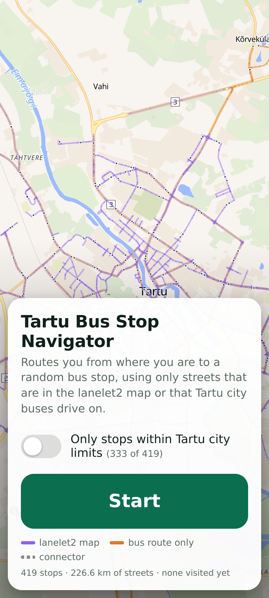
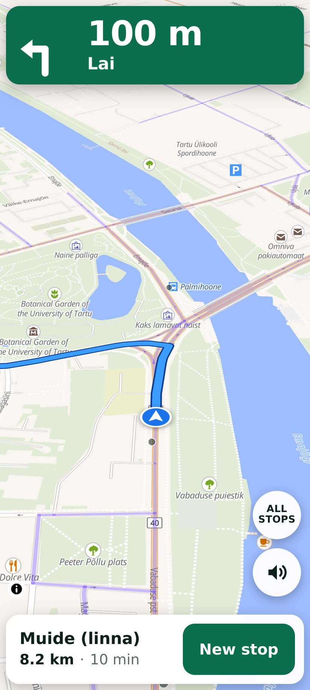
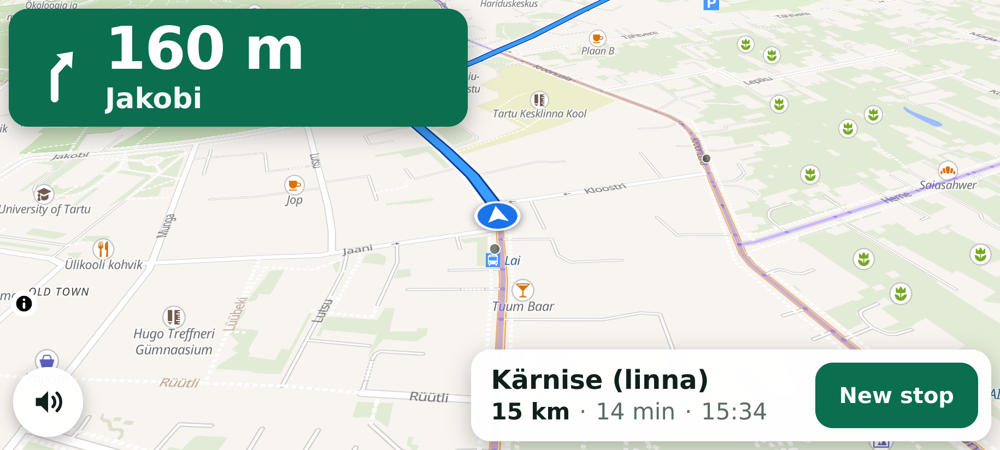

# Tartu Bus Stop Navigator

A turn-by-turn navigation web app for phones that picks a **random bus stop in Tartu, Estonia** and
guides you there from your current location — driving only on a restricted set of streets:

* streets covered by a [Lanelet2](https://github.com/fzi-forschungszentrum-informatik/Lanelet2) HD map, or
* streets that Tartu city buses drive on (OpenStreetMap route relations with `network="Tartu linn"`).

**Live app: <https://karljohan99.github.io/tartu-bus-stop-navigator/>**
(open it on a phone and allow location access; add `?sim=4` to watch a simulated drive on a desktop)

<p>
  
  
</p>
<p></p>

## Features

* One tap to start; one big button for the next random stop. Visited stops are remembered on the device
  and not picked again until all have been visited.
* Large next-turn banner (arrow, distance, street name), spoken instructions, remaining distance / time / ETA.
* Heading-up map that follows the car, automatic rerouting when you leave the route, screen kept awake.
* Optional limit to stops inside the Tartu city limits (switch on the start screen, button while driving).
* Routing runs entirely in the browser — the site is static files, there is no backend. If basemap tiles
  cannot be loaded, the app falls back to a plain drawing of the road network.
* Light and dark theme (follows the device), portrait and landscape layouts.

On the map, purple streets are covered by the Lanelet2 map, orange streets are bus-route-only and dashed
grey pieces are connectors (see below).

## How the street network is built

`build/build_graph.py` combines three inputs into `web/data.json`:

| Input | Used for |
|---|---|
| OpenStreetMap extract (`build/fetch_osm.sh`, Overpass API) | street geometry, one-ways, turn restrictions, speed limits, street names, bus route relations |
| Lanelet2 map (`.osm`) | deciding which streets are "mapped" |
| GeoPackage with a `destinations` point layer and a `sites` polygon layer | the bus stops and the city-limits polygon |

1. OSM ways are split into segments at junctions.
2. A segment is **lanelet-covered** in a driving direction if at least 70 % of points sampled along it have
   a lanelet centreline within 9 m that runs the same way (±35°).
3. A segment is a **bus street** if its way is a member of a Tartu city bus route relation and private cars
   may use it (bus-only roads are left out).
4. OSM bus relations often omit roundabout pieces or the opposite carriageway, which leaves some bus streets
   cut off. Such gaps are bridged with the shortest ordinary public road (at most 600 m) — the **connectors**.
5. Only the largest strongly connected part of the network is kept, so every stop that is offered can be
   reached from every street and left again.
6. Each stop is snapped to the correct side of the street using its `heading` attribute, or, where that is
   missing, the driving direction of the lanelet underneath it.

Current data set: 227 km of streets (204 km lanelet-covered, 22 km bus-route-only, 2 km connectors) and
419 routable stops out of 434, 333 of them inside the city limits. `build/report.json` lists the stops that
could not be connected and other build statistics.

The router (`web/router.js`) is a Dijkstra search over *directed street segments*, which lets it honour
turn restrictions and forbid U-turns except at dead ends. A route takes a few milliseconds on a phone.

## Running locally

```bash
HTTP=1 ./serve.sh 8000     # http://localhost:8000/?sim=4  – simulated drive for desktop testing
./serve.sh                 # HTTPS on :8443 with a self-signed certificate, for a phone on the same network
```

Browsers only provide the location to pages served over HTTPS (or `localhost`).

URL options: `?sim=N` simulated drive at N× speed, `&from=lat,lon` simulation start point,
`?nobase` disable basemap tiles.

## Rebuilding the data

Requirements: Python 3.8+ with `numpy`, `scipy`, `pyproj`, `shapely`; Node.js for the router test.
The Lanelet2 map and the GeoPackage are not part of this repository.

```bash
build/fetch_osm.sh                                    # → raw/osm.json
python3 build/build_graph.py --lanelet tartu_large.osm --gpkg tartu_large.gpkg
node build/test_router.js                             # routes to every stop and checks that the paths are legal
./deploy.sh                                           # publish web/ to GitHub Pages (after committing)
```

`build_graph.py` also writes `build/debug_segments.geojson`, which can be opened in QGIS to inspect the
matching (`cov_f` / `cov_b` are the coverage fractions per direction). The matching thresholds are constants
at the top of the script; `--city-site` selects which polygon of the `sites` layer is the city limit.

## Repository layout

```
web/      the app (static): index.html, app.js, app.css, router.js, data.json, roads.json
build/    data pipeline: fetch_osm.sh, build_graph.py, test_router.js, report.json
docs/     screenshots
serve.sh  local HTTP/HTTPS server      deploy.sh  publish web/ to the gh-pages branch
```

## Limitations

* This is a research/utility tool, not a certified navigation product. The street data may be outdated or
  wrong — always follow the actual road signs and traffic rules, and do not operate the phone while driving.
* Turn restrictions that use a *way* as the via member are ignored (rare in Tartu).
* Voice guidance is in English and does not read out street names.

## Data and attribution

* Street data in `web/data.json` and `web/roads.json` is derived from
  [OpenStreetMap](https://www.openstreetmap.org/copyright), © OpenStreetMap contributors, available under the
  [Open Database License (ODbL)](https://opendatacommons.org/licenses/odbl/).
* Basemap: [OpenFreeMap](https://openfreemap.org) / [OpenMapTiles](https://openmaptiles.org), rendered with
  [MapLibre GL JS](https://maplibre.org).
